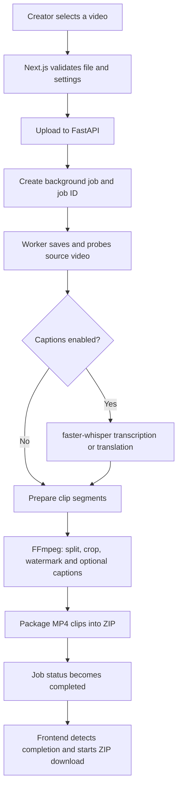

# FRAMEFLOW — Drama & Entertainment Shorts Cutter

<p align="center">
  
  
  
  
  
</p>

<p align="center">
  <strong>Turn long-form drama and entertainment videos into vertical, share-ready clips.</strong><br />
  Upload once. Process in the background. Download your clips in one ZIP package.
</p>

<p align="center">
  <a href="#features">Features</a> ·
  <a href="#how-it-works">How it works</a> ·
  <a href="#quick-start">Quick start</a> ·
  <a href="#deployment">Deployment</a> ·
  <a href="#api-reference">API reference</a> ·
  <a href="#troubleshooting">Troubleshooting</a>
</p>

---

## Project overview

**FRAMEFLOW — Drama & Entertainment Shorts Cutter** is a web application built with a **Next.js** frontend and a **Python FastAPI** backend. It splits a source video into clips of up to 60 seconds, reframes each clip to a vertical 9:16 canvas, adds the `Drama & Entertainment` watermark, optionally generates and burns captions, and packages the finished MP4 files into a ZIP archive.

The browser receives a job ID after upload instead of waiting for the entire video encode in the upload request. The interface checks the job status every three seconds and starts the ZIP download when processing completes.

> **Important:** Background processing is currently implemented as an in-process queue on one backend instance. This is a useful single-instance starting point, not a durable distributed job system. See [known limitations](#known-limitations--production-readiness).

## Project information

| Field | Details |
|---|---|
| Project | FRAMEFLOW — Drama & Entertainment Shorts Cutter |
| Ownership | **PCMDK369™** |
| Developers | **Mr. Murli Dhar & Team** |
| Contact | [support.pcmdkai@gmail.com](mailto:support.pcmdkai@gmail.com) |
| Frontend | Next.js, React, TypeScript |
| Backend | Python, FastAPI |
| Video processing | FFmpeg and FFprobe |
| Speech recognition | faster-whisper (optional captions) |
| Output | MP4 clips inside a ZIP archive |
| Upload limit in application | 2 GB; hosting providers may enforce lower limits |

## Contents

- [Features](#features)
- [Processing specifications](#processing-specifications)
- [How it works](#how-it-works)
- [Technology stack](#technology-stack)
- [Repository structure](#repository-structure)
- [Quick start](#quick-start)
- [Environment variables](#environment-variables)
- [Deployment](#deployment)
- [API reference](#api-reference)
- [Caption behaviour](#caption-behaviour)
- [Security and privacy](#security-and-privacy)
- [Known limitations & production readiness](#known-limitations--production-readiness)
- [Troubleshooting](#troubleshooting)
- [CI checks](#ci-checks)
- [Roadmap](#roadmap)
- [Ownership and contact](#ownership-and-contact)

## Features

### Video processing
- Accepts **MP4, MOV, MKV, WEBM and M4V** source videos.
- Splits video into sequential segments of **up to 60 seconds**. The last segment may be shorter.
- Reframes clips to a **1080 × 1920 vertical 9:16** canvas using scale-and-center-crop.
- Encodes video as H.264 MP4 with AAC audio when an audio stream exists.
- Preserves source audio when available.
- Applies a permanent lower-right **Drama & Entertainment** watermark to each exported clip.
- Packages all generated MP4 clips into a single ZIP download.

### Automatic captions (optional)
- Uses local **faster-whisper** speech recognition.
- Caption modes: Original spoken language, English, and Hindi.
- Caption templates: Auto recommend, Classic, Bold, and Minimal.
- Caption colors: White, Yellow, Cyan, and Pink.
- Caption sizes: Small, Medium, and Large.
- Burns captions into the exported clips when enabled.
- Allows captions to be disabled if they are not needed or if the hosting environment is resource-constrained.

### Background job experience
- Uploads the source video and returns a job identifier.
- Processes the video in a backend worker after the upload request finishes.
- Exposes queued, processing, completed, and failed job states.
- Polls job status from the frontend every three seconds.
- Starts ZIP download when the job reports completion.
- Lets the user switch to another browser tab while the server is processing, as long as the backend service remains available.

### Interface and validation
- Responsive creator-focused interface.
- Video selection and drag-and-drop upload.
- Local video preview before upload.
- File extension, empty-file and 2 GB application-limit validation.
- Backend connection indicator and refresh action.
- Caption settings with a style sample preview.
- Error and job status messages.

## Processing specifications

| Setting | Current behaviour |
|---|---|
| Maximum upload size | 2 GB application limit |
| Accepted extensions | `.mp4`, `.mov`, `.mkv`, `.webm`, `.m4v` |
| Segment duration | 60 seconds maximum |
| Aspect ratio | 9:16 |
| Output resolution | 1080 × 1920 |
| Video codec | H.264 / libx264 |
| Audio codec | AAC, if source audio exists |
| Frame rate | 30 fps |
| Video preset | FFmpeg `veryfast` |
| Video quality setting | CRF 23 |
| Watermark | `Drama & Entertainment`, lower-right |
| Output packaging | One ZIP containing MP4 clips |
| Caption engine | faster-whisper, optional |
| Job status polling | Every 3 seconds |

The 2 GB application limit does not override the request-size, execution-time, memory, CPU or disk limits of the selected hosting provider.

## How it works



### Job states

| State | Meaning |
|---|---|
| `queued` | Upload is saved and waiting for a worker |
| `processing` | The backend is processing the source video |
| `completed` | ZIP archive is ready for download |
| `failed` | Processing failed; the status response contains an error message |

## Technology stack

| Layer | Technology | Purpose |
|---|---|---|
| Frontend | Next.js / React | Web interface and upload workflow |
| Language | TypeScript | Frontend types and maintainability |
| API | FastAPI | Upload, job status, health check and download endpoints |
| Video tools | FFmpeg / FFprobe | Media probing, clipping, cropping, encoding and watermark |
| Speech recognition | faster-whisper | Optional local speech-to-text and English translation |
| Queue | Python ThreadPoolExecutor | Single-instance background processing |
| Archive | Python zipfile | ZIP generation |
| CI | GitHub Actions | Frontend build and backend smoke checks |

## Repository structure

```text
60sec/
├── .github/
│   └── workflows/
│       └── ci.yml              # Frontend build and backend checks
├── backend/
│   ├── app/
│   │   └── main.py             # FastAPI routes and video pipeline
│   └── requirements.txt        # Python dependencies
├── frontend/
│   ├── app/
│   │   ├── page.tsx            # Main upload and job interface
│   │   ├── globals.css         # Visual design and responsive styling
│   │   └── layout.tsx           # App layout and metadata
│   ├── package.json
│   └── next.config.mjs
└── README.md
```

## Quick start

### Prerequisites

Install the following before starting:

- Node.js 20 or later and npm.
- Python 3.10 or later.
- FFmpeg and FFprobe.
- FFmpeg build with the `drawtext` and `subtitles` filters; the subtitles filter requires libass.
- Internet access on first run if faster-whisper must download its model.

Check the media tools:

```bash
ffmpeg -version
ffprobe -version
ffmpeg -filters | grep -E 'drawtext|subtitles'
```

### Install FFmpeg

**Ubuntu / Debian**

```bash
sudo apt-get update
sudo apt-get install -y ffmpeg
```

**Termux on Android**

```bash
pkg update
pkg install ffmpeg python nodejs
```

Some Termux FFmpeg builds may not include the `subtitles` filter. Check the filter list above. If the filter is missing, captions may fail until an FFmpeg build with libass support is installed.

### 1. Start the backend

From the repository root:

```bash
cd backend
python -m venv .venv
```

Activate the virtual environment:

**Linux / macOS / Termux**

```bash
source .venv/bin/activate
```

**Windows PowerShell**

```powershell
.venv\Scripts\Activate.ps1
```

Install dependencies and start FastAPI:

```bash
python -m pip install --upgrade pip
pip install -r requirements.txt
uvicorn app.main:app --host 0.0.0.0 --port 8000
```

Backend health endpoint: [http://127.0.0.1:8000/health](http://127.0.0.1:8000/health)

### 2. Start the frontend

Open a second terminal from the repository root:

```bash
cd frontend
npm install
```

Create `frontend/.env.local` for local development:

```dotenv
NEXT_PUBLIC_API_URL=http://127.0.0.1:8000
```

Then run:

```bash
npm run dev
```

Open [http://localhost:3000](http://localhost:3000).

> Keep the backend and frontend running in separate terminals. The frontend's API URL is a public browser-side URL, not a secret.

## Environment variables

### Frontend

| Variable | Required | Description |
|---|---|---|
| `NEXT_PUBLIC_API_URL` | Yes for deployed frontend | Public base URL of the FastAPI service, without a trailing slash |
| `NEXT_PUBLIC_RECAPTCHA_SITE_KEY` | Yes for admin login | Public Google reCAPTCHA v2 checkbox site key; register the production Vercel domain |

Example:

```dotenv
NEXT_PUBLIC_API_URL=https://your-backend.example.com
```

### Backend

| Variable | Required | Default | Description |
|---|---|---|---|
| `CORS_ORIGINS` | For deployment | `http://localhost:3000,http://127.0.0.1:3000` | Comma-separated allowed frontend origins |
| `RECAPTCHA_SECRET_KEY` | Yes for admin login | Unset | Private Google reCAPTCHA secret; set only in Render, never in frontend or Git |
| `SUPABASE_URL` | Yes for admin access | Unset | Supabase project URL used to validate admin sessions |
| `SUPABASE_PUBLISHABLE_KEY` | Yes for admin access | Unset | Supabase publishable key used by backend auth validation |
| `ADMIN_EMAIL` | Yes for admin access | Unset | The single allowed admin email address |
| `VIDEO_WORKERS` | No | `1` | Maximum simultaneous background video jobs |
| `JOB_STORAGE_DIR` | No | System temporary directory | Root directory for job files |
| `WHISPER_MODEL` | No | `base` | faster-whisper model name |
| `WHISPER_DEVICE` | No | `cpu` | Whisper device, e.g. CPU |
| `WHISPER_COMPUTE_TYPE` | No | `int8` | Whisper compute type |
| `LLM_API_KEY` | Hindi fallback only | Unset | Secret API key for optional OpenAI-compatible chat completions endpoint |
| `LLM_API_URL` | Hindi fallback only | Unset | Full chat-completions endpoint URL |
| `LLM_MODEL_ID` | Hindi fallback only | Unset | Provider model identifier |

**Never commit API keys to GitHub.** Set secrets in the backend hosting provider's environment configuration. Do not put secrets in `NEXT_PUBLIC_*` variables.

## Deployment

### Recommended simple deployment

- **Frontend:** Vercel, with the project root set to `frontend`.
- **Backend:** Render or another Python host that supports FFmpeg and background processing.
- **Persistent queue/storage:** not included in the current single-instance version; see production-readiness notes below.

#### Admin login and robot verification

1. Register a Google reCAPTCHA v2 checkbox site in the Google reCAPTCHA admin console and include the production Vercel hostname plus any Vercel alias used for testing.
2. Add `NEXT_PUBLIC_RECAPTCHA_SITE_KEY` to the Vercel project environment.
3. Add `RECAPTCHA_SECRET_KEY` as a private environment variable in Render (or sync the `render.yaml` Blueprint and enter it securely).
4. Confirm `NEXT_PUBLIC_ADMIN_EMAIL` in Vercel and `ADMIN_EMAIL` in Render both equal `support.pcmdkai@gmail.com`.
5. In Supabase Authentication, create or recover the admin user for that email using the password reset flow. Add the exact production frontend URL to Supabase Auth URL Configuration → Redirect URLs so the reset link can return to the app. Never commit or share the password.
6. Redeploy both services after changing environment variables. The login form intentionally stays disabled until reCAPTCHA is configured and verified server-side.

#### Frontend deployment

1. Import the GitHub repository into Vercel.
2. Set the Root Directory to `frontend`.
3. Add environment variable `NEXT_PUBLIC_API_URL` with the public URL of your deployed backend.
4. Deploy the frontend.

The `NEXT_PUBLIC_API_URL` value is embedded into the frontend at build time. Redeploy the frontend after changing it.

#### Backend deployment

For a Python web service, use the `backend` directory as the root where supported.

**Build command**

```bash
pip install -r requirements.txt
```

**Start command**

```bash
uvicorn app.main:app --host 0.0.0.0 --port $PORT
```

Configure these backend environment variables:

```dotenv
CORS_ORIGINS=https://your-frontend.vercel.app
VIDEO_WORKERS=1
WHISPER_MODEL=base
WHISPER_DEVICE=cpu
WHISPER_COMPUTE_TYPE=int8
```

Replace the example frontend origin with the real deployed domain. If you use a custom domain, include its exact origin in `CORS_ORIGINS`. Ensure FFmpeg and FFprobe are installed in the backend runtime.

### Deployment checklist

- [ ] Frontend `NEXT_PUBLIC_API_URL` points to the live backend URL.
- [ ] Backend `CORS_ORIGINS` includes the exact frontend origin.
- [ ] `/health` returns a successful response.
- [ ] FFmpeg and FFprobe are available in the backend container.
- [ ] FFmpeg has the `drawtext` filter; captions additionally need `subtitles` / libass.
- [ ] Backend disk space and memory are sufficient for source video, clips and ZIP.
- [ ] Any optional LLM credentials are set only on the backend.
- [ ] A test video has been processed end-to-end on the actual hosting provider.

## API reference

The API is served by FastAPI. Interactive API documentation is available at `/docs` when enabled by the deployment.

### `GET /health`

Returns backend status and capability/configuration indicators.

Example response:

```json
{
  "status": "ok",
  "captions": "local-faster-whisper",
  "watermark": "Drama & Entertainment",
  "emergency_llm_configured": false
}
```

The `emergency_llm_configured` field indicates whether all three optional LLM environment variables are present. It does not guarantee that the provider key is valid or the remote service is reachable.

### `POST /api/jobs`

Accepts a multipart video upload and queues a background job.

Multipart fields:

| Field | Type | Default | Allowed values |
|---|---|---|---|
| `file` | File | Required | MP4, MOV, MKV, WEBM, M4V |
| `captions_enabled` | Boolean | `true` | `true` / `false` |
| `caption_language` | String | `original` | `original`, `english`, `hindi` |
| `caption_style` | String | `auto` | `auto`, `classic`, `bold`, `minimal` |
| `caption_color` | String | `white` | `white`, `yellow`, `cyan`, `pink` |
| `caption_size` | String | `medium` | `small`, `medium`, `large` |

Successful queue creation returns HTTP `202 Accepted`, with a job ID and status URL. Processing itself may continue after the request returns.

Example response:

```json
{
  "job_id": "generated-job-id",
  "status": "queued",
  "message": "Upload complete. Processing will continue in the background.",
  "status_url": "/api/jobs/generated-job-id"
}
```

### `GET /api/jobs/{job_id}`

Returns the current job status and message. Unknown or lost job IDs return HTTP `404`.

### `GET /api/jobs/{job_id}/download`

Downloads the generated ZIP when the job is complete. Returns HTTP `409` if the job is not yet complete and `404` if the job or archive is unavailable.

## Caption behaviour

- **Original:** recognizes speech in its detected language.
- **English:** uses faster-whisper's translation task to produce English text.
- **Hindi:** if speech is detected as Hindi or Urdu, local recognition is used. For other detected languages, the optional emergency LLM fallback is used to translate recognized segments into Hindi.
- The optional LLM fallback is not used for ordinary cutting, Original captions or English captions.
- The LLM fallback has a 35-second HTTP timeout. Provider-specific limits and billing still apply.
- Caption text is burned into the exported video; it is not a separate editable subtitle file.
- The frontend caption preview is a style sample, not a live preview of the encoded video.

Automatic captions require CPU/RAM and may download a model on first use. To test the video pipeline without speech recognition, disable captions in the interface.

## Security and privacy

- API credentials for the optional translation fallback must remain on the backend.
- Never commit `.env` files, access tokens or provider API keys.
- Use a narrow-scope provider key and configure provider-side usage limits.
- Set `CORS_ORIGINS` to the intended frontend origins rather than leaving broad origins in production.
- Uploaded videos are written to backend storage for processing. Use only content you own or have permission to process.
- Avoid uploading confidential or sensitive footage to infrastructure you do not control.
- The current application does not provide user accounts, per-user access control, rate limiting, or a persistent job history dashboard.
- The job status and ZIP download endpoints do not currently authenticate users. Do not expose this as a multi-tenant service for sensitive content without adding authentication and authorization.
- Hosting providers may retain logs or temporary disk data under their own policies; review provider settings and delete/retention requirements before production use.

## Known limitations & production readiness

The current version is designed as a functional single-instance starting point. Before using it for a high-volume or multi-user production service, address these items:

1. **In-memory job state:** job metadata lives in process memory. A backend restart or redeploy can make active jobs inaccessible.
2. **Single-instance assumption:** multiple backend instances do not share the in-memory queue or job state.
3. **Temporary disk:** generated ZIP files need a retention and cleanup policy. Durable object storage is not wired in yet.
4. **No persistent dashboard:** after a page reload, the frontend does not restore a previous job automatically.
5. **No authentication:** job status and download routes need authorization before use with private or multi-user uploads.
6. **Resource limits:** video encoding and Whisper can use substantial CPU, RAM and disk. Keep `VIDEO_WORKERS=1` on small instances initially.
7. **Provider request limits:** a hosting platform may reject uploads or terminate jobs that exceed its body-size, execution-time or disk limits.
8. **End-to-end validation:** CI checks build/import/routes, but a real video must also be tested on the deployment environment to validate FFmpeg filters, model download, audio streams and storage.

### Suggested production upgrade path

- Move job metadata to a durable database.
- Use Redis with Celery/RQ or a managed job queue for durable background processing.
- Store source videos and generated archives in object storage such as Supabase Storage or S3.
- Add authentication, authorization, upload quotas, rate limiting and job ownership checks.
- Add job expiration, automatic file cleanup, retries and structured logs.
- Add integration tests using a small, generated sample video.
- Add monitoring for CPU, memory, disk capacity, job duration and failures.

## Troubleshooting

### Frontend says “SERVER OFFLINE”

1. Confirm the backend process is running.
2. Open `/health` on the backend's public URL.
3. Verify `NEXT_PUBLIC_API_URL` and redeploy the frontend if it changed.
4. Confirm the frontend origin is listed in backend `CORS_ORIGINS`.

### CORS error in browser console

Set `CORS_ORIGINS` to the exact frontend origin, including `https://` and any custom domain. Redeploy the backend after changing it.

### FFmpeg or FFprobe not found

Install FFmpeg in the backend environment and confirm both `ffmpeg -version` and `ffprobe -version` work inside the running service.

### Captions fail

- Try turning captions off to isolate the video encoding pipeline.
- Confirm faster-whisper dependencies install correctly and the model can be downloaded.
- Check available memory and CPU.
- Confirm the FFmpeg `subtitles` filter exists and libass support is enabled.
- Review backend logs for the detailed processing error.

### Watermark or subtitle filter error

Check FFmpeg's `drawtext` and `subtitles` filters. Minimal FFmpeg builds may omit filters used by the application.

### Job disappears or status returns 404

The current job queue is in-memory and not durable. A backend restart, redeploy, or request routed to a different instance may lose access to the job. Durable shared job storage is needed for production reliability.

### Upload fails for large videos

The app's maximum is 2 GB, but the hosting provider may impose a lower request-body limit or insufficient temporary disk. Check provider logs and resource limits.

## CI checks

GitHub Actions runs these checks on pushes and pull requests targeting `main`:

- **Frontend build:** installs frontend dependencies and runs `npm run build`.
- **Backend check:** installs Python dependencies, compiles the backend package, imports the FastAPI app and checks required routes.

CI success does not replace an end-to-end test with a real video on the target host. See the [latest workflow runs](https://github.com/pcmdk369/60sec/actions).

## Roadmap

Potential improvements, not claims of currently implemented functionality:

- Durable background queue and persistent job dashboard.
- User accounts and private job history.
- Object storage integration and automatic retention cleanup.
- Retry/cancel controls and clearer processing progress.
- Upload quotas and deployment-aware size limits.
- Automated integration tests with sample video fixtures.
- More deployment presets and operational monitoring.

## Ownership and contact

**Ownership:** PCMDK369™  
**Developers:** Mr. Murli Dhar & Team  
**Email:** [support.pcmdkai@gmail.com](mailto:support.pcmdkai@gmail.com)

This repository and its branding are maintained under PCMDK369™. No open-source license is granted by this README. Unless a separate license file or written permission says otherwise, treat the source and branding as proprietary and obtain permission before redistribution or commercial reuse.

---

<p align="center">
  <strong>PCMDK369™</strong><br />
  <em>Built for creators. Designed for focused video workflows.</em><br />
  <a href="mailto:support.pcmdkai@gmail.com">Contact the team</a>
</p>
